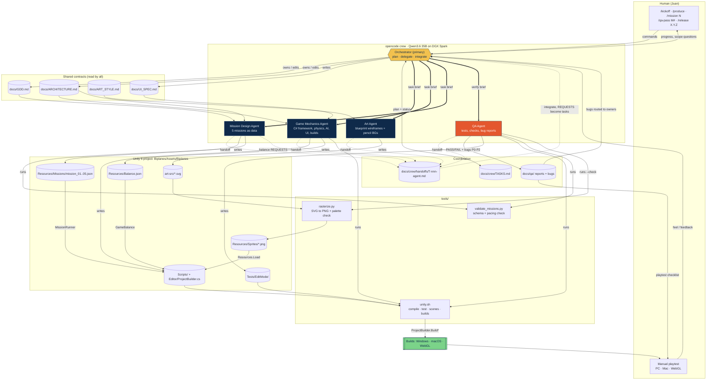
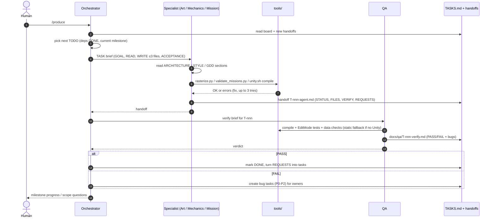
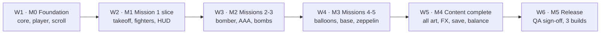

# Biplanes crew: roles, connections and data flow

## 1. Roles and data flow

**Legend:** thick arrows `==>` are delegations (Task tool briefs). Dotted arrows `-.->`
are handoffs back to the orchestrator. Solid arrows are reads, writes and tool runs.

## 2. One task, end to end

## 3. Milestones (six weeks)

